# Dieta+ — diagramas de arquitetura de software

> Documento comum aos 3 repositórios (`dieta-backend`, `dieta-mobile` e o `dieta-frontend`, arquivado), com o mesmo conteúdo nos repositórios ativos. Ao mudar, atualize as 3 cópias.
> Os diagramas são Mermaid e o GitHub os desenha direto no navegador. O texto de cada regra está em `visao-geral.md`, `integracao.md`, `backend.md`, `mobile.md` e `web.md`. Se algum diagrama divergir deles, o texto vale.

Níveis, no estilo C4:

1. [Contexto](#1-contexto): quem usa o Dieta+ e com quais sistemas externos ele conversa.
2. [Containers](#2-containers): as aplicações dos 3 repositórios e a infraestrutura.
3. [Componentes do backend](#3-componentes-do-backend): os módulos do monólito.
4. [Componentes do app](#4-componentes-do-app-kmp): as camadas do app KMP.
5. [Componentes do site](#5-componentes-do-site-angular): o site Angular (pós-MVP).
6. [Fluxos principais](#6-fluxos-principais): login, sync offline, publicar dieta, convite e pagamento.
7. [Implantação](#7-implantação): o que roda onde.

## 1. Contexto

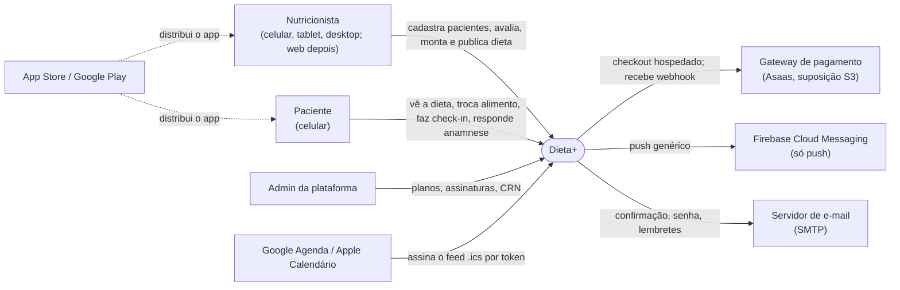

## 2. Containers

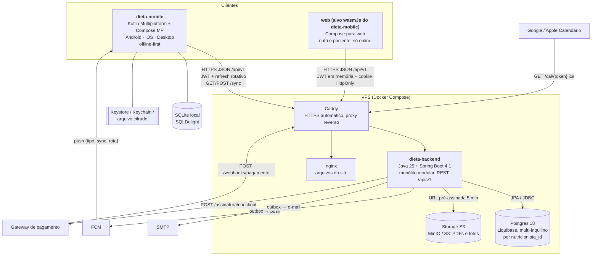

Regras que o diagrama resume:

- O backend decide tudo: permissão, plano, limite e regra. App e site só mostram.
- O app lê só do SQLite local e sincroniza em segundo plano. O site não tem banco local e usa os endpoints REST com `If-Match`.
- O desktop não recebe FCM: ele sincroniza periodicamente.
- Nada de fila externa no MVP. Push e e-mail saem por uma tabela de pendências (outbox) lida por jobs `@Scheduled`.

## 3. Componentes do backend

Pacote raiz `com.br.dietamais`. Cada módulo só expõe o subpacote `api` aos outros, e o Spring Modulith (ou ArchUnit) verifica essa fronteira num teste.

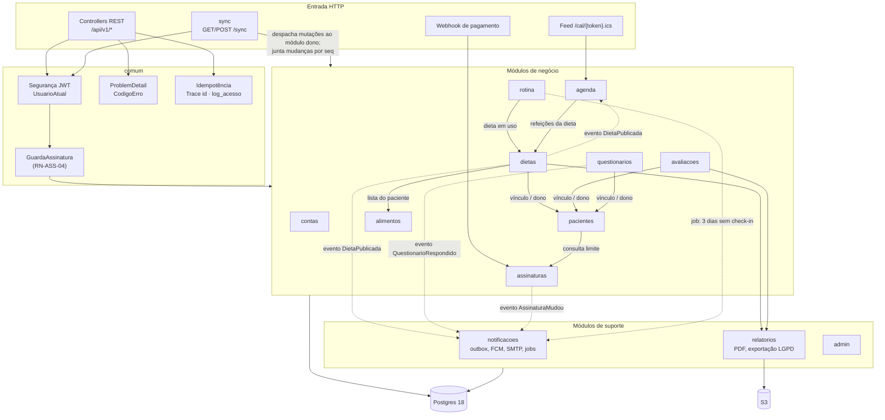

Camadas dentro de cada módulo:

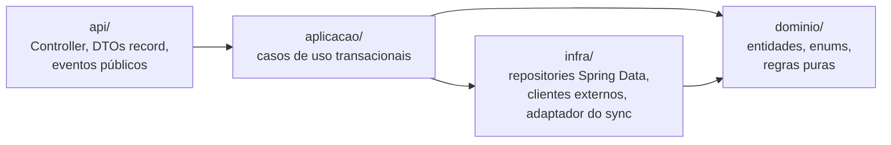

## 4. Componentes do app KMP

Pacote `org.br.dietamais` em `shared/src/commonMain/kotlin`. Os apps `androidApp`, `iosApp` e `desktopApp` só inicializam a plataforma.

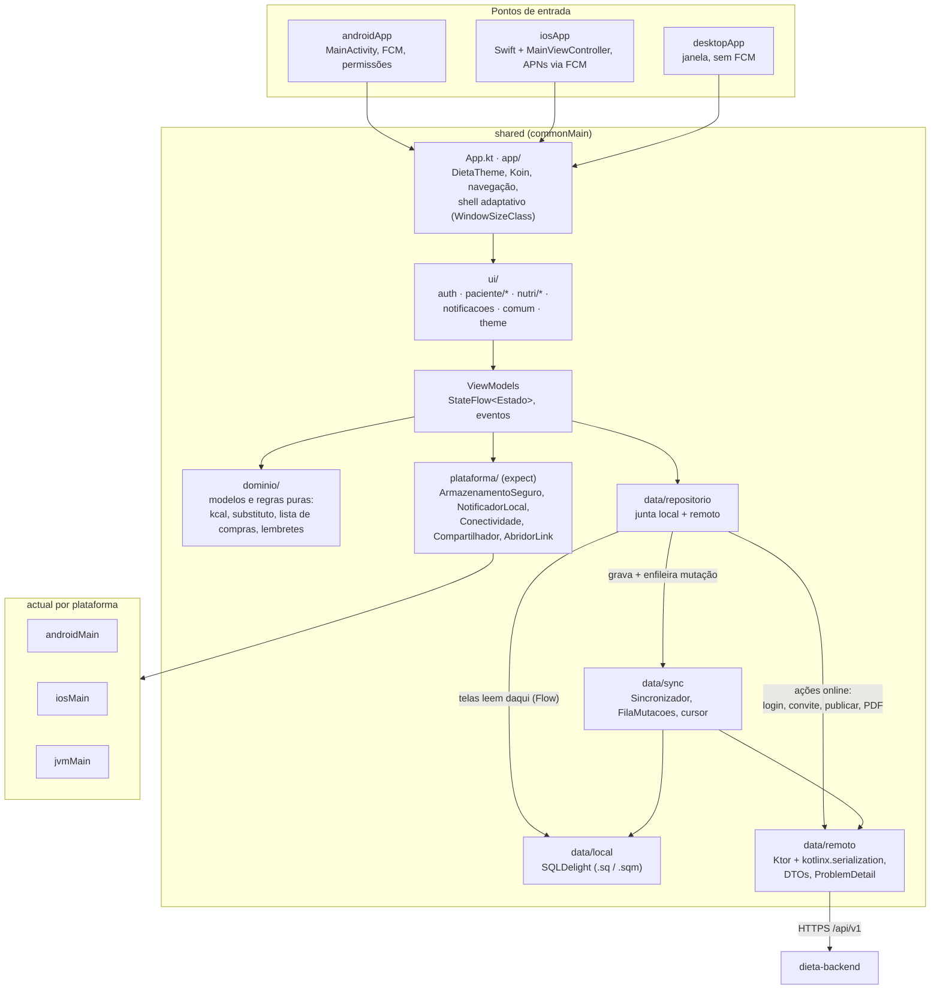

Layout adaptativo (detalhe em `docs/design/plataformas.md` no `dieta-mobile`):

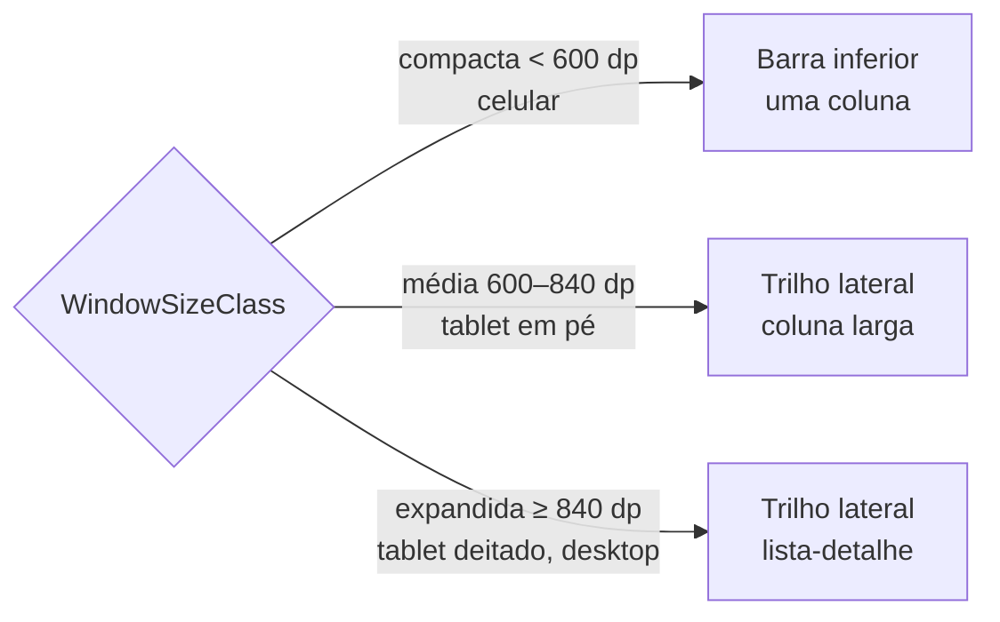

## 5. Componentes do site Angular

Fase P1, depois do MVP. O site só funciona online e não tem regra própria.

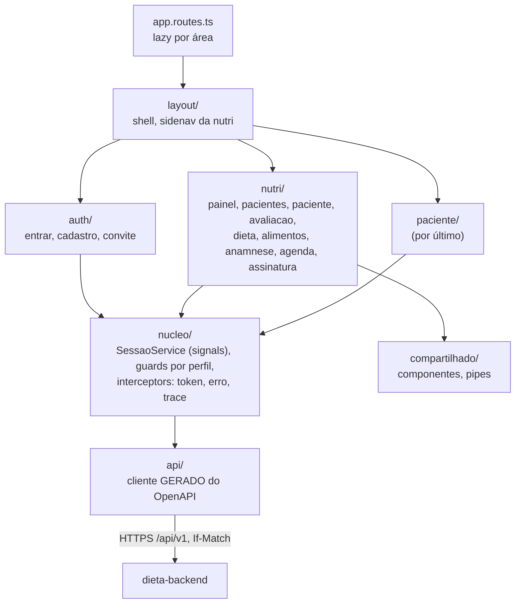

## 6. Fluxos principais

### Login e renovação de token

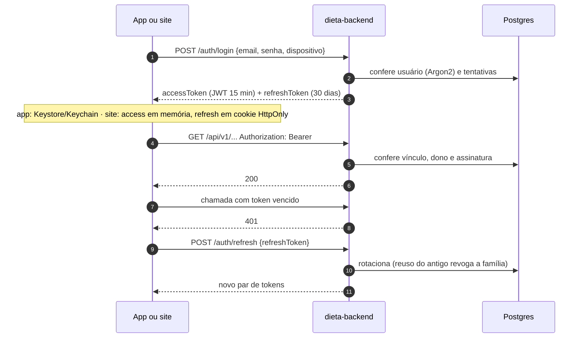

### Sincronização offline do app

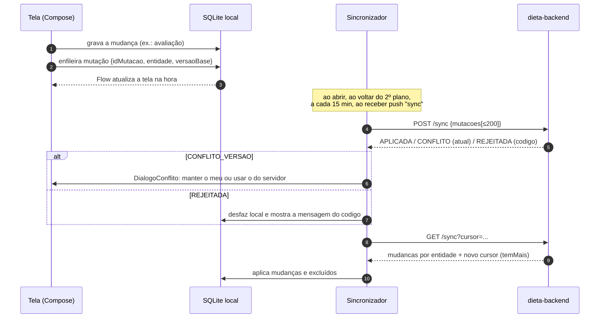

### Publicar dieta e avisar o paciente

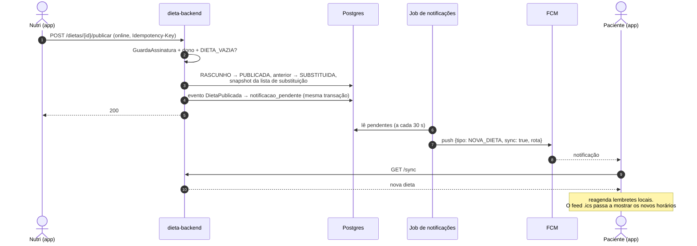

### Convite e vínculo com consentimento

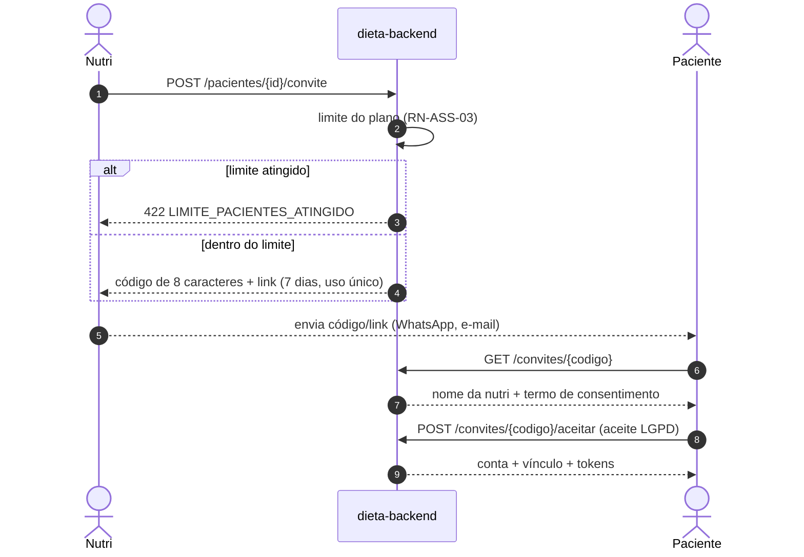

### Assinatura da nutri (fase 6)

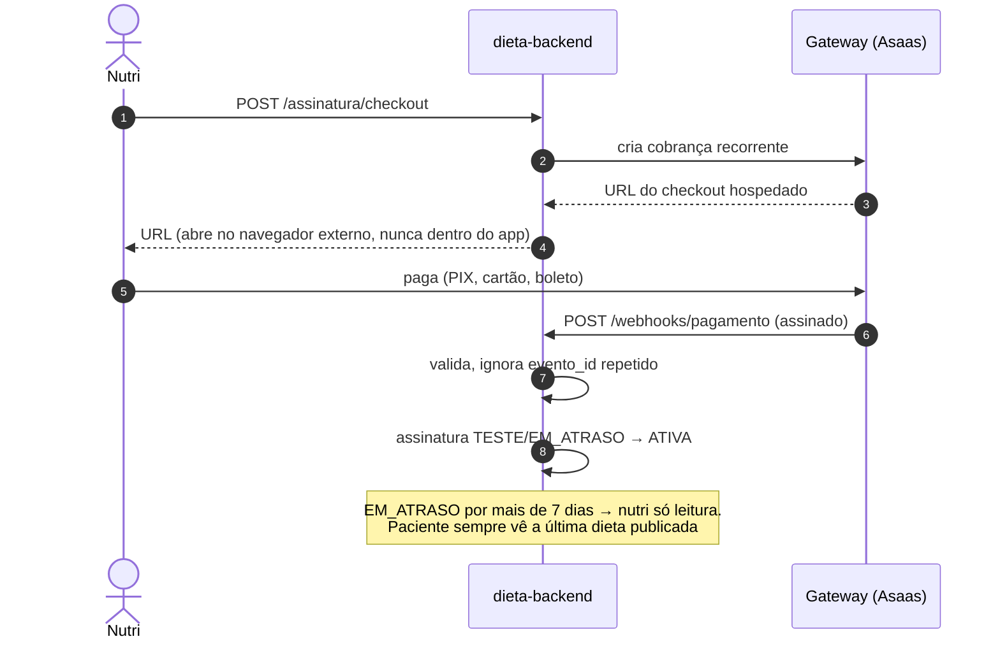

## 7. Implantação

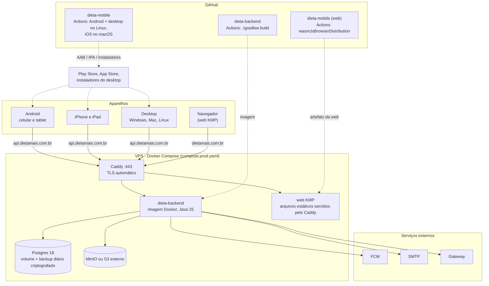

Em dev, o `compose.yaml` do backend sobe Postgres 18, Mailpit (`localhost:8025`) e MinIO. O site em dev usa o `compose.yaml` do próprio repositório, e o emulador Android acessa a API em `http://10.0.2.2:8080`.
